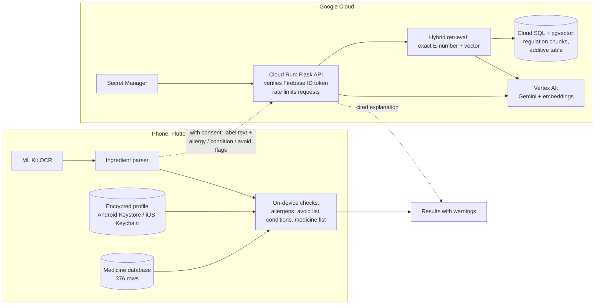

# NutriLens

NutriLens turns a photo of a food label or a medicine strip into advice that fits one person's health profile: their allergies, conditions, avoid list and medicines. It is designed around a simple split: **anything safety-critical is checked on the phone, and the cloud is used only to explain a flag with a citation to a published regulation.**

> Information only, not medical advice.

## Why this design

Food-label apps usually send the whole profile and the photo to a hosted model and show whatever comes back. NutriLens is designed to do the opposite:

- **Safety checks do not need a network.** Allergen, avoid-list and medicine-list checks run on the device.
- **Health data stays local by default.** The profile is stored encrypted on the phone. The cloud request carries label text plus allergy, condition and avoid-list entries, and never the name, age, weight, medicines or the photo.
- **No claim without a source.** The explanation service answers only from retrieved regulation text, and a statement without a valid citation is dropped by code before it reaches the app.
- **No model keys in the app.** The app holds a short-lived Firebase identity token. Model access belongs to the backend's service account.

## Architecture



What runs where, and the reasoning behind each choice, is in [docs/ARCHITECTURE.md](docs/ARCHITECTURE.md).

## Intended features

| Feature | Where it runs | Design |
|---|---|---|
| Label scan | Phone | ML Kit reads the label; a parser isolates the ingredient section. |
| Allergen and avoid-list alerts | Phone | Pattern libraries for 7 allergen groups (tree nuts, peanuts, lactose, gluten, soy, shellfish, eggs), plus the user's own avoid list and hidden-sugar rules for diabetes. |
| Ingredient-position score | Phone | A transparent heuristic that weights harmful ingredients by their position in the list. The weights are this project's own design, not taken from a regulation. |
| Marketing claim check | Phone | Compares front-of-pack claims such as "no added sugar" with the ingredient list. |
| Generic-medicine lookup | Phone | Search by brand or composition over a curated 376-row dataset. |
| Medicine vs. your profile | Phone | Compares a scanned medicine with your medicine list and allergies by name and active ingredient. It does not know drug interactions or allergy classes, and the screen says so. |
| Cited explanations | Cloud | Retrieval over FSSAI and EU regulation text, then an explanation in which every statement cites a source. If nothing is found the answer is "no source found". |
| Cloud OCR option | Cloud | Intended for labels the on-device reader cannot read; the user chooses it per scan because it sends the photo. |
| Privacy controls | Phone and cloud | Consent before any cloud request, a delete-all-my-data action, no server-side storage of user data by design. See [docs/PRIVACY.md](docs/PRIVACY.md). |
| Natural-language search | Phone | A small TFLite intent classifier over a 200-product catalogue (6 intents: top rated, worst, sugar free, high protein, palm-oil free, vegan). |
| Medicine reminder screen | Phone | Interface for setting medicine times. |

## Evidence and verification

The repository includes backend tests, Dart tests, and an evaluation harness for label photos: OCR error rate, ingredient parsing, allergen detection with every missed allergen listed, citation correctness, latency and cost per scan. Its method is in [evals/README.md](evals/README.md). Figures are published only in `evals/results/RESULTS.md`, which `evals/report.py` generates from raw runs. This README quotes no performance figures.

What is built, what is verified, and what comes next is tracked in the [roadmap](docs/ROADMAP.md).

## Setup

### Prerequisites

- Flutter SDK (Dart `^3.7.2`) and an Android device or emulator
- Python 3.12 or newer
- For deployment: a Google Cloud project with billing, and the `gcloud` CLI

### 1. Clone and configure

```bash
git clone https://github.com/pr1t4m-d3y/App-Nutrilens.git
cd App-Nutrilens
cp app_config.example.json app_config.json
cp backend/.env.example backend/.env
```

`app_config.json` and `backend/.env` are git-ignored. `app_config.json` holds the Firebase project settings and the API URL, which are identifiers rather than secrets. The app contains no model API keys. Leave `app_config.json` as is to run the app with cloud explanations off.

### 2. Run the Flutter app

```bash
flutter pub get
flutter run --dart-define-from-file=app_config.json
```

Without a configured backend the app is designed to run entirely on the device.

### 3. Run the backend locally

```bash
make backend-install
gcloud auth application-default login
# set FIREBASE_PROJECT_ID, GOOGLE_CLOUD_PROJECT and the DB_* values in backend/.env
set -a; source backend/.env; set +a
make backend-run
```

### 4. Load the regulation corpus

Download the regulation documents unchanged from the official sites, record them in [data/regulations/SOURCES.md](data/regulations/SOURCES.md), describe them in `data/regulations/manifest.json`, then:

```bash
cd backend
python -m nutrilens_api.rag.ingest --manifest ../data/regulations/manifest.json --additives ../data/additives.csv
```

### 5. Deploy to Cloud Run

```bash
cp deploy/config.example.env deploy/config.env     # fill in project, region, billing account, budget
bash deploy/00_budget.sh                           # budget alert first
bash deploy/10_infra.sh                            # service account, registry, Cloud SQL, secret
bash deploy/20_deploy.sh                           # build and deploy; prints the service URL
bash deploy/teardown.sh                            # removes what the scripts created
```

The container is a multi-stage image that runs as a non-root user, with a least-privilege service account and the database password in Secret Manager. Cloud SQL is the main fixed cost; check current pricing before running `10_infra.sh`.

### 6. Tests, lint, size

```bash
make backend-lint backend-test       # Python
make flutter-analyze flutter-test    # Dart
make size LABEL=baseline             # APK / AAB sizes, appended to docs/size_log.csv
```

## Repository layout

| Path | Contents |
|---|---|
| `lib/` | Flutter app: screens, providers, on-device services |
| `backend/` | Flask API, retrieval pipeline, tests, Dockerfile |
| `deploy/` | Cloud Run, Cloud SQL, Secret Manager and teardown scripts |
| `data/regulations/` | Regulation sources list and manifest |
| `evals/` | Label dataset format, runners, report generator |
| `scripts/` | App size reporting |
| `docs/` | Architecture, privacy, audit, plan, roadmap, user feedback |

## Documentation

- [Architecture](docs/ARCHITECTURE.md)
- [Privacy and health-data handling](docs/PRIVACY.md)
- [Roadmap](docs/ROADMAP.md)
- [Audit of earlier claims against the code](docs/AUDIT.md)
- [Eval method](evals/README.md)

## Design system

The interface uses a translucent "liquid glass" navigation bar, bento-style cards and Plus Jakarta Sans.
