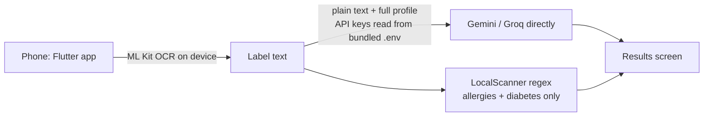
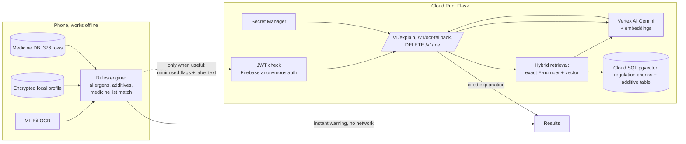

# Architecture: hybrid on-device + cloud

**Status: the "Today" section describes the app before the cloud service was added. The "Target" section is the design the code follows. The code has not been compiled or run, and parts of it (regulation data, the on-device additive table, deployment) are not in place yet; see `docs/ROADMAP.md`.**

## Today

Problems this design has, all from the audit: keys ship inside the app, the full health profile is sent to third-party model APIs, there is no auth, medicines are not checked offline, and the profile is not saved.

## Target

## What runs where, and why

| Capability | Location | Why (to be backed by measurements in `evals/results/RESULTS.md`) |
|---|---|---|
| OCR on clear labels | Phone (ML Kit) | No network, no image leaves the device, no per-scan cost. |
| OCR on hard labels (curved, low-contrast, multilingual) | Cloud (Gemini vision) | Only when on-device OCR looks poor. Costs latency and sends the image, so it is opt-in per scan. |
| Allergen, additive and medicine-list warnings | Phone | Safety-critical, must work without signal, and the user's profile never has to leave the device for this step. |
| Cited explanations ("why is this flagged, under which rule") | Cloud (RAG + Gemini) | Needs the regulation corpus and a model. Output is only shown with a citation. |
| Regulation search | Cloud (pgvector) | Corpus is too large and changes too often to ship in the APK. |
| Model keys | Cloud (Secret Manager) | Never in the app. |
| Medical-profile storage | Phone, encrypted | Server keeps nothing by default. |
| Web client (optional) | Cloud OCR path only | The ML Kit plugin does not support web. |

Every "why" above is a design intent. Latency, cost and recall figures go in `RESULTS.md` after the eval runs. None are claimed here.

## Proposed API surface (Flask)

| Endpoint | Purpose | Notes |
|---|---|---|
| `POST /v1/explain` | Label text + minimised profile flags in; cited explanation out | JWT required; request-size limit; rate limited |
| `POST /v1/ocr-fallback` | Image in; text out | Image processed in memory, not stored; the app asks the user per scan |
| `POST /v1/analyze` | Same request as `/v1/explain`, answered by the four-agent pipeline | See `docs/MULTI_AGENT.md`; longer timeout and more memory |
| `POST /v1/search` | Query in; verbatim regulation passages with document and locator out | Retrieval only, no model |
| `DELETE /v1/me` | Delete anything held for this user | Even if the server stores nothing by default, the endpoint and its test exist |
| `GET /healthz` | Liveness | No auth, no data |

## Consistency rule

The phone's compact additive table and the cloud's structured table are **generated from one source file** (`data/additives.*`, to be created in B1/B2), so the offline and online answers cannot drift apart. A test asserts this.

## Retrieval design (B1)

1. Chunk regulations by structure (regulation, article, annex entry), keeping the regulation and article number and any E-number in each chunk's metadata.
2. Exact match first (E-number or INS code lookup in the structured table).
3. Vector search over chunks for free-text questions (Vertex AI embeddings, pgvector).
4. Merge, then generate. Each claim must cite a chunk id. If retrieval returns nothing relevant, answer "no source found".

## Failure behaviour

| Failure | Behaviour |
|---|---|
| No network | Phone rules run; UI says cloud explanation is unavailable. |
| Cloud error or timeout | Same as above. No fake or uncited explanation is produced. |
| Retrieval finds nothing | "No source found", not a guess. |
