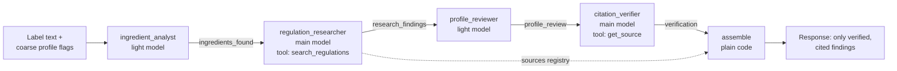

# Multi-agent label review

`POST /v1/analyze` runs a four-agent pipeline built on Google's Agent Development Kit (ADK). It takes the same request as `/v1/explain` and returns the same response shape, so the two can be compared on identical labels. The single-pass endpoint stays as the baseline.

**Status:** the code is written (`backend/nutrilens_api/agents/`) and has never been compiled or run. The integration assumptions that remain to be checked are listed at the end of this page and in `docs/ROADMAP.md` (item M1).

## Why agents here

One prompt that retrieves, judges, personalises and checks its own work does four jobs with one context. Splitting them gives three things that can be measured:

- **A separate checking pass.** A verifier reads the full text of each cited source and rules on whether it supports the claim. In the single-pass design the model only has to name a source id.
- **Cost control by model tier.** Extraction and profile ranking run on the lighter model. Research and verification run on the main model.
- **A bounded tool loop.** The researcher decides what to search for and may search more than once, within a fixed budget.

Whether this is worth the extra latency and cost is an empirical question. The evaluation plan below answers it.

## The pipeline



| Agent | Job | Model tier | Tool | Writes to state |
|---|---|---|---|---|
| `ingredient_analyst` | Lists ingredients and additive codes in label order | Light | none | `ingredients_found` |
| `regulation_researcher` | Searches the regulations and drafts findings that cite source ids | Main | `search_regulations` | `research_findings` |
| `profile_reviewer` | Ranks findings against the coarse flags; adds a short note; changes nothing else | Light | none | `profile_review` |
| `citation_verifier` | Reads each cited source in full and rules supported or not | Main | `get_source` | `verification` |

The agents run in sequence under an ADK `SequentialAgent`. State is shared through the session; each agent's final answer is stored under its `output_key`.

## What code enforces and what the agents are asked to do

Agents are asked to behave. Code does not rely on that.

| Guarantee | Where it is enforced |
|---|---|
| A source id can only come from a search the tool actually ran | `agents/tools.py` keeps a per-request registry; `agents/assemble.py` rejects any id not in it |
| No finding reaches the app without a verifier verdict of `supported` (the boolean `true`) | `assemble.py`; a finding with no verdict counts as unsupported |
| No finding reaches the app without at least one valid citation | `enforce_citations` in `explain.py`, shared with the single-pass endpoint |
| Search count is capped | `search_regulations` refuses after `AGENT_MAX_SEARCHES` |
| Label text is data, not instructions | Delimited in the analyst's instruction; no agent can act on it because the tools are read-only |
| Nothing from the user is stored | Sessions are in memory, created per request and deleted at the end; the user key passed to ADK is a hash |

## Cost and latency

- Four model stages plus the researcher's and verifier's tool calls, so more calls than `/v1/explain`.
- Every response reports per-agent seconds and token counts under `agents.stages`, and the same numbers go to the structured log.
- Cloud Run settings for this endpoint: 1 GiB memory and a 120 s request timeout (`deploy/20_deploy.sh`).
- Token counts are summed across agents. Cost is computed with one price pair, so it overstates the cost when the light model is cheaper.

## Trying it

The request is the one `/v1/explain` takes. The label text is yours; the token is a current Firebase ID token for the project.

```bash
curl -sS -X POST "$SERVICE_URL/v1/analyze" \
  -H "Authorization: Bearer $NUTRILENS_ID_TOKEN" \
  -H "Content-Type: application/json" \
  -d '{"label_text": "Ingredients: sugar, palm oil, salt, sodium benzoate (E211)", "profile": {"allergies": [], "conditions": [], "avoid": ["palm oil"]}}'
```

Response shape (types only, no sample values, because none has been produced):

```text
status            "ok" | "no_source_found"
ingredients[]     name, impact ("bad" | "neutral" | "good"),
                  details[]  (reason, optional profile note, "Source: <title>, <locator>" lines),
                  citations[] (source ids)
sources[]         id, title, locator
model             main model id
usage             input_tokens, output_tokens   (summed over all agents)
agents            searches, unsupported_dropped, uncited_dropped,
                  stages[]  agent, events, seconds, input_tokens, output_tokens
```

To use it from the app, set `"NUTRILENS_USE_AGENTS": true` in `app_config.json` and rebuild. There is no in-app switch.

## Evaluation plan

Both endpoints are measured on the same reviewed label set:

```bash
NUTRILENS_ID_TOKEN=... python evals/run_cloud.py --base-url "$SERVICE_URL" --endpoint explain
NUTRILENS_ID_TOKEN=... python evals/run_cloud.py --base-url "$SERVICE_URL" --endpoint analyze
python evals/report.py
```

`RESULTS.md` then shows, side by side: latency percentiles, mean tokens in and out, per-agent seconds and tokens, searches per run, findings rejected by the verifier, and citation correctness from human review of each pipeline's sheet. `evals/run_safety.py` runs the same citation and prompt-injection cases against both endpoints.

**Decision rule, fixed before any measurement:** the multi-agent pipeline becomes the app's default only if its human-reviewed citation correctness is higher than the single-pass pipeline's on the same labels, and the measured latency and cost are acceptable to the owner. Otherwise it stays available as an option and the write-up says so.

## Known limits

- The stages are sequential. Nothing runs in parallel.
- The verifier is itself a model and can be wrong in either direction. Human review of citations remains the ground truth.
- A finding must clear two gates (verified and cited), so the pipeline will return "no source found" more often than the single-pass one when sources are thin.
- Each request builds its agents and an in-memory session; there is no reuse across requests.
- No ADK evaluation framework or tracing exporter is configured. Latency comes from the per-stage numbers above and Cloud Trace correlation in the logs.

## Version choices

- ADK **1.39.1**, not 2.x. ADK 2.0 introduced a new workflow API whose programmatic runner documentation could not be confirmed, and this code was written without being able to run it. The 1.x classes used here (`LlmAgent`, `SequentialAgent`, `Runner`, `InMemorySessionService`, `ToolContext`) are the ones whose behaviour is well documented.
- `google-genai` **2.34.0**, because ADK 1.39.1 requires `google-genai` at least 2.9 and below 3. The 2.34.0 README still creates a Vertex AI client with `enterprise=True`, which `llm.py` uses.

## Assumptions to confirm on first run

1. `Runner(agent=, app_name=, session_service=)`, `InMemorySessionService.create_session / get_session / delete_session` and `Runner.run_async` have the signatures used in `agents/runner.py` in ADK 1.39.1.
2. An `instruction` given as a function is used as written, without `{name}` templating, so braces in label text and JSON descriptions are safe.
3. ADK builds its Gemini clients from the `GOOGLE_GENAI_USE_ENTERPRISE`, `GOOGLE_GENAI_USE_VERTEXAI`, `GOOGLE_CLOUD_PROJECT` and `GOOGLE_CLOUD_LOCATION` environment variables that `configure_vertex_environment` and the deploy script set, with `google-genai` 2.34.0.
4. `LlmAgent` accepts `generate_content_config` together with `tools`, and `output_key` stores the agent's final text in state.
5. Events carry `author` and `usage_metadata` as `agents/runner.py` reads them.
6. The container, with ADK's dependencies, fits in 1 GiB.
